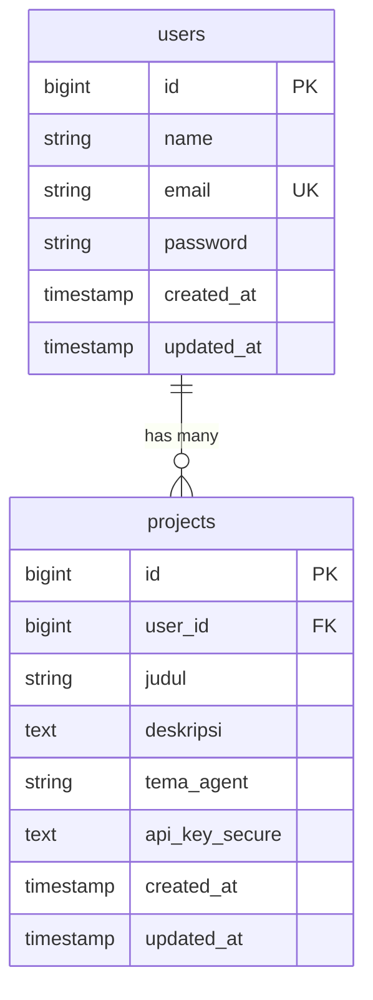

# PBKK-W6-Kel10 – Secure Academic Portal

Portal portofolio akademik berbasis **Laravel 12 + Laravel Breeze** untuk mengelola data akun pengguna dan rancangan proposal proyek **Agentic AI**. Mendukung koneksi database **PostgreSQL** (pgAdmin) maupun **MySQL** (XAMPP).

---

## Proyek Mandiri Agentic AI

### Judul
**Personalized Agentic AI for Intelligent Job Discovery and Application Preparation**

### Konsep Singkat
Sistem ini merupakan AI agent yang membantu pencari kerja dalam menemukan dan menentukan peluang pekerjaan yang paling sesuai dengan profil mereka. Pengguna memberikan informasi mengenai latar belakang pendidikan, keterampilan, pengalaman, proyek, dan preferensi karier, kemudian agent menganalisis berbagai lowongan pekerjaan dan membandingkannya dengan profil pengguna untuk menentukan tingkat relevansi dan prioritas setiap peluang. 

Agent selanjutnya mengidentifikasi kompetensi dan pengalaman pengguna yang paling relevan terhadap pekerjaan yang dipilih serta menyesuaikan materi lamaran agar lebih sesuai dengan kebutuhan posisi tersebut. Dengan demikian, sistem tidak hanya berfungsi sebagai pencari lowongan atau pembuat CV, tetapi sebagai *career application agent* yang membantu pengguna mengambil keputusan mengenai pekerjaan yang perlu diprioritaskan sekaligus mempersiapkan lamaran yang sesuai secara personal.

### Tujuan
- **Efisiensi Seleksi:** Mengurangi proses pencarian dan seleksi lowongan yang dilakukan secara manual.
- **Pencocokan Presisi:** Membantu pengguna menemukan pekerjaan yang paling relevan dengan profil dan tujuan kariernya.
- **Tailoring Lamaran:** Membantu menyesuaikan CV dan materi lamaran berdasarkan karakteristik setiap lowongan pekerjaan.
- **Rekomendasi Personal:** Memberikan rekomendasi yang lebih personal dibandingkan pencarian pekerjaan berbasis keyword biasa.

---

## Pemenuhan Aturan & Spesifikasi Teknis

| Komponen | Spesifikasi Penugasan | Implementasi |
|---|---|---|
| **Tabel `users`** | Kredensial login Laravel Breeze | `name`, `email` (unique), `password`, timestamps |
| **Tabel `projects`** | Proposal ide Agentic AI | `id`, `user_id`, `judul`, `deskripsi`, `tema_agent`, `api_key_secure`, timestamps |
| **Foreign Key** | Terikat ke `users.id` secara cascade | `$table->foreignId('user_id')->constrained('users')->cascadeOnDelete()` |
| **Column Modifiers** | `unique()` email, `nullable()` deskripsi, `default('Ollama')` tema_agent | Diterapkan pada file migrasi |
| **Model Protection** | Array `$fillable` pada model `Project` | Dilindungi dari serangan mass assignment |
| **Keamanan Kunci API** | Enkripsi `api_key_secure` | Cast Eloquent `encrypted` (AES-256-CBC) |
| **Factory & Seeder** | `ProjectFactory` & `DatabaseSeeder` | Otomatis 15 user acak (masing-masing 2 project) + 1 akun demo |
| **Akun Demo Penguji** | `dosenpbkk@its.ac.id` | Siap pakai dengan proyek demo utama |
| **Query Dashboard** | Hanya data user yang sedang login | `Auth::user()->projects()->latest()->get()` |

---

## Akun Demo Penguji

| Email | Password | Role |
|---|---|---|
| `dosenpbkk@its.ac.id` | `password` | Akun Demo Dosen / Penguji |

*Catatan: Seluruh akun mahasiswa hasil seeding juga menggunakan password default: `password`.*

---

## Panduan Instalasi & Menjalankan Proyek

### 1. Clone Repositori
```bash
git clone https://github.com/sholihdinrizky/elephant-in-the-schema.git
cd elephant-in-the-schema
```

### 2. Install Dependensi PHP & JavaScript
```bash
composer install
npm install
```

### 3. Setup File Environment
```bash
# Windows Command Prompt / PowerShell
copy .env.example .env

# Linux / MacOS
# cp .env.example .env

# Generate Application Key
php artisan key:generate
```

### 4. Konfigurasi Database pada `.env`

Sesuaikan dengan DBMS yang Anda gunakan:

**Pilihan A — PostgreSQL (pgAdmin):**
```env
DB_CONNECTION=pgsql
DB_HOST=127.0.0.1
DB_PORT=5432
DB_DATABASE=pbkk-w6-auth
DB_USERNAME=postgres
DB_PASSWORD=password_postgres_anda
```

**Pilihan B — MySQL (XAMPP):**
```env
DB_CONNECTION=mysql
DB_HOST=127.0.0.1
DB_PORT=3306
DB_DATABASE=pbkk_w6_auth
DB_USERNAME=root
DB_PASSWORD=
```

### 5. Jalankan Migrasi & Database Seeder
```bash
php artisan migrate:fresh --seed
```

### 6. Build Aset Frontend
```bash
npm run build
```

### 7. Jalankan Server Lokal
```bash
php artisan serve
```
Akses portal melalui browser di **`http://localhost:8000`**.

---

## Struktur Database



---

## Tim Pengembang
- **Mata Kuliah:** Pemrograman Berbasis Kerangka Kerja (PBKK) - Kelas B
- **Departemen:** Teknik Informatika, Fakultas FTEIC, Institut Teknologi Sepuluh Nopember (ITS)
