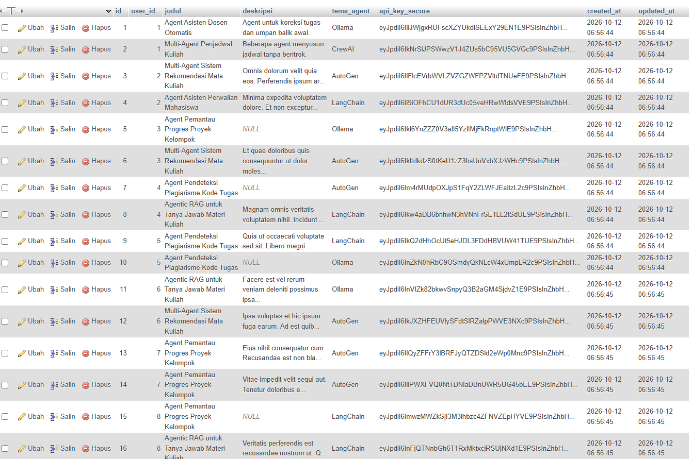
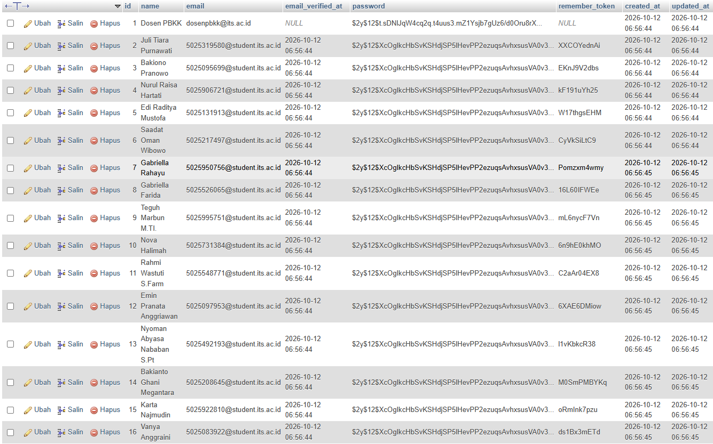
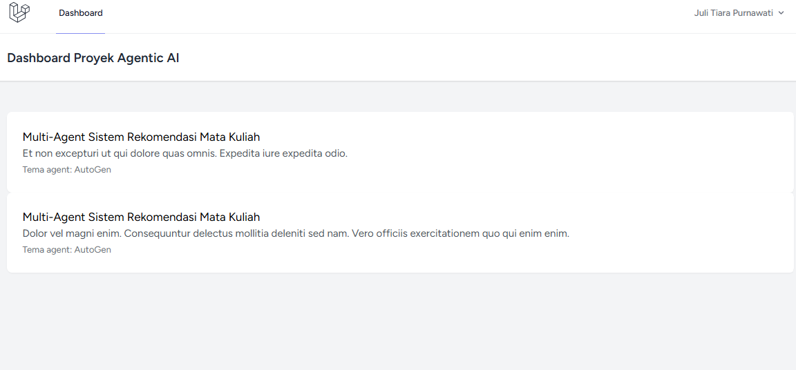

Readme · MD

# PBKK-W6-Kel10 - Secure Academic Portal

Portal portofolio akademik berbasis **Laravel + Laravel Breeze + MySQL**.
Aplikasi menyimpan data user (mahasiswa) dan rancangan proposal proyek **Agentic AI** milik masing-masing user, lengkap dengan seeder data dummy dan akun demo untuk penguji.

## Fitur

-   Register dan login memakai Laravel Breeze.
-   Tabel `users` (bawaan Breeze) dan tabel `projects` dengan relasi satu user memiliki banyak project.
-   Foreign key `projects.user_id` ke `users.id` dengan `ON DELETE CASCADE`.
-   Model `Project` dengan `$fillable` (proteksi mass assignment) dan enkripsi otomatis pada kolom `api_key_secure`.
-   `ProjectFactory` dan `DatabaseSeeder`: 15 user acak, masing-masing 2 project, ditambah 1 akun demo.
-   Dashboard hanya menampilkan project milik user yang sedang login, diurutkan dari yang terbaru.

## Struktur Database

**users** (bawaan Breeze): `id`, `name`, `email` (unique), `password`, dan kolom bawaan lainnya.

**projects**

| Kolom                      | Tipe      | Keterangan                                   |
| -------------------------- | --------- | -------------------------------------------- |
| `id`                       | bigint    | Primary key                                  |
| `user_id`                  | bigint    | Foreign key ke `users.id`, cascade on delete |
| `judul`                    | string    | Judul ide proposal                           |
| `deskripsi`                | text      | Nullable                                     |
| `tema_agent`               | string    | Default `Ollama`                             |
| `api_key_secure`           | text      | Terenkripsi otomatis (cast `encrypted`)      |
| `created_at`, `updated_at` | timestamp |                                              |

---

### Tabel projects di mysql



## Prasyarat

Pastikan sudah terpasang di komputer:

-   **PHP** (versi yang dipakai saat pengembangan: 8.4)
-   **Composer**
-   **Node.js dan npm**
-   **Git**
-   **XAMPP** (untuk MySQL dan phpMyAdmin)
    Cek dengan perintah berikut, semuanya harus menampilkan versi:

```bash
php -v
composer -V
node -v
npm -v
git --version
```

## Cara Menjalankan

### 1. Clone repository

```bash
git clone https://github.com/Kifrx/PBKK-W6-Kel10.git
cd PBKK-W6-Kel10
```

### 2. Install dependensi

```bash
composer install
npm install
```

### 3. Siapkan file environment

Windows (CMD):

```bash
copy .env.example .env
```

Mac / Linux / Git Bash:

```bash
cp .env.example .env
```

Lalu buat application key:

```bash
php artisan key:generate
```

### 4. Siapkan MySQL di XAMPP

1. Buka **XAMPP Control Panel** (disarankan Run as administrator).
2. Klik **Start** pada **MySQL** sampai statusnya hijau (Running). Catat port yang tertera, biasanya `3306`.
3. Buka phpMyAdmin di browser: `http://localhost/phpmyadmin`.
4. Klik tab **Databases**, isi nama database `portofolio`, pilih collation `utf8mb4_unicode_ci`, lalu klik **Create**.

### 5. Atur koneksi database di `.env`

Buka file `.env`, lalu pastikan bagian database seperti berikut (hapus tanda `#` di depan barisnya kalau ada):

```env
DB_CONNECTION=mysql
DB_HOST=127.0.0.1
DB_PORT=3306
DB_DATABASE=portofolio
DB_USERNAME=root
DB_PASSWORD=
```

Sesuaikan `DB_PORT` dengan port MySQL di XAMPP, dan `DB_DATABASE` dengan nama database yang dibuat di langkah 4.

Setelah mengubah `.env`, bersihkan cache konfigurasi:

```bash
php artisan config:clear
```

### 6. Jalankan migration dan seeder

```bash
php artisan migrate --seed
```

Kalau ingin mengulang dari nol (menghapus semua tabel lalu membuat ulang):

```bash
php artisan migrate:fresh --seed
```

Hasil yang benar: tabel `users` berisi 16 baris (1 akun demo + 15 user acak) dan tabel `projects` berisi 32 baris. Cek lewat phpMyAdmin pada database `portofolio`.

### 7. Jalankan aplikasi

Buka **dua terminal** di folder project.

Terminal 1 (server Laravel):

```bash
php artisan serve
```

Terminal 2 (aset frontend):

```bash
npm run dev
```

Buka alamat yang tampil di terminal 1, biasanya `http://127.0.0.1:8000`.

## Akun Demo

Gunakan akun ini untuk login dan melihat dashboard yang sudah berisi data siap presentasi:

| Field    | Nilai                 |
| -------- | --------------------- |
| Email    | `dosenpbkk@its.ac.id` |
| Password | `password`            |

Semua user mahasiswa acak hasil seeder juga memakai password `password`. Lihat email mereka di tabel `users` lewat phpMyAdmin.



---

## Halaman Dashboard



## Teknologi

-   Laravel dan Laravel Breeze (Blade)
-   MySQL (XAMPP)
-   Faker untuk data dummy
-   Laravel Pint untuk format kode (PSR-12): `vendor\bin\pint`
